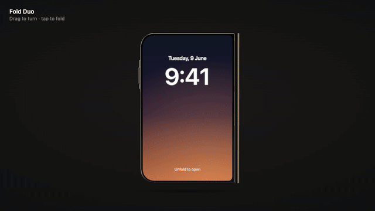

# Fold Duo



A book-style foldable phone rendered in real time with [three.js](https://threejs.org).
Drag to turn it, tap (or press Space) to fold it, or scrub the slider.

**[Live demo → heyayush.in/duo](https://heyayush.in/duo)**: the engine running with real
content on the displays (a portfolio laid out as a home screen).

The trick is in the displays: while the hinge turns, each screen's picture stays where it
would be on the open display and the glass sweeps across it. The half that turns away
softens and dims towards its far edge, and the inner panel bends smoothly around the hinge.

```bash
npm install
npm run dev        # http://localhost:5173
npm test           # unit tests (Node's built-in runner)
npm run build      # type-check and build into dist/
```

## How it works

| File | What it does |
| --- | --- |
| `src/device/dimensions.ts` | Device proportions in scene units. |
| `src/device/device.ts` | Builds the device from primitives: two bodies, the flexible inner panel, the cover display, camera plateau, buttons and hinge spine. `setFold(angle)` poses it (0 open … π closed). |
| `src/device/fold-glass.ts` | Shader patch for both display materials: screen lock, turn-away blur and dimming, the hinge bend of the inner panel, and the cover's back art. |
| `src/device/materials.ts`, `shapes.ts` | Physical materials and rounded-rectangle outlines. |
| `src/hinge.ts` | A spring between 0 and π with hard stops that absorb most of the impact. |
| `src/timeline.ts` | Timed swings (smootherstep) and the auto-play loop. |
| `src/camera-rig.ts`, `src/lighting.ts` | Framing that follows the device's footprint; a procedural studio environment and contact shadow. |
| `src/screens/sample-screens.ts` | Placeholder pictures painted with Canvas 2D. |
| `src/main.ts` | Wires it together: input, playback and the frame loop. |

### Screen lock

Both display materials are standard `MeshPhysicalMaterial`s patched in `onBeforeCompile`.
Every fragment knows its position in *body space* (the device frame, hinge on the line
x = 0, z = 0). The picture is sampled at that position's (x, y) inside the open display's
rectangle, a front-on orthographic view, so the picture stays fixed while the glass
moves. The cover's picture is anchored to the cover's hinge-side edge, so it slides away
with that edge as the device opens.

### Turn-away

How far a bit of glass has turned from the viewer (`1 − cos tilt`) times its distance from
the hinge drives a blur radius and a dimming factor. The blur is a centre tap plus an
8-tap golden-angle spiral, with the mip level raised to fill between taps.

### Back art

Open, the cover faces away and its locked picture has slid off the glass. It then shows a
second picture laid flat on the glass by its own UVs (here, a sticker wall), faded in over
the last 10% of the opening.

### Hinge bend

Within a narrow strip around the hinge, the inner panel follows a quadratic Bézier from
the fixed half to the turning half. Its middle control point lies on the hinge, rotated by
half the fold angle, so the strip meets both halves tangentially. Normals are rebuilt from
the curve's tangent.

## Using your own screens

`createDevice(inner, cover, back?)` takes the two screen textures and optional back art. Keep their aspect ratios to those in
`sample-screens.ts` (inner ≈ 1.26 : 1, cover ≈ 0.62 : 1). Canvas or video textures work;
set `needsUpdate` when a canvas changes.

## Notes

- This is an independent design study. It is not affiliated with, endorsed by or modelled
  on assets from any phone maker. Product names belong to their owners.
- Requires WebGL 2.

## License

[MIT](LICENSE). three.js is a dependency under its own MIT license.
